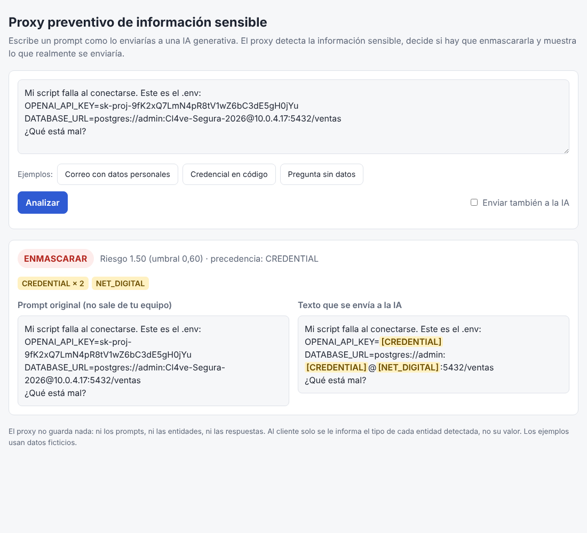

# Mecanismo preventivo de información sensible en prompts para IA generativa

Trabajo de grado de Andrés Saldarriaga. Este repositorio contiene el mecanismo híbrido que detecta información personal y secretos técnicos en un prompt antes de enviarlo a una IA generativa (regex con validadores + NER BERT + heurística de riesgo), el proxy que lo aplica, los scripts de entrenamiento y evaluación, y los resultados reportados en el documento.



## Resultados principales

Prueba ciega sobre 45 prompts reales anotados en Doccano (ejecutada una sola vez):

| Sistema | F1 | F2 | F2 id. directos y secretos | Fuga residual | Prompts limpios enmascarados |
|---|---|---|---|---|---|
| **Híbrido (este trabajo)** | **0,800** | **0,837** | **0,861** | **0,098** | **0/27** |
| Presidio (línea base) | 0,375 | 0,502 | 0,572 | 0,176 | 17/27 |

- MEDDOCAN test: F2 0,947. Corpus sintético test: F2 0,961.
- Acuerdo entre anotadores (50 textos, segundo anotador: un compañero): kappa de Cohen por token 0,919; F1 por mención 0,835.
- Proxy de extremo a extremo con el modelo final: 165/165 prompts enviados exactamente con el texto evaluado; latencia mediana 15,9 ms (p95 28,4 ms) en Colab con GPU T4.

Detalle en [`resultados/resumen_final.md`](resultados/resumen_final.md).

## Estructura

| Carpeta | Contenido |
|---|---|
| `docs/` | Matriz de revisión de literatura (Anexos A y B de la tesis) |
| `mecanismo/` | Taxonomía de 13 etiquetas, detector regex, detector NER, fusión, heurística, enmascaramiento, métricas y línea base Presidio |
| `proxy/` | Proxy FastAPI (`servidor.py`) y página de demostración (`demo.html`) |
| `scripts/` | Generación del corpus sintético, conversión de MEDDOCAN, AI4Privacy y WikiANN, preparación y partición del corpus de Doccano, entrenamiento del NER, evaluación de detección y de respuestas, acuerdo entre anotadores y prueba del proxy |
| `colab/` | Notebooks de Google Colab con los que se entrenó y evaluó (GPU T4) |
| `datos/` | Corpus sintético (`dev` y `test`). Los demás datos no se incluyen; ver [`datos/README.md`](datos/README.md) |
| `modelos/` | Reportes de validación. Los pesos no se incluyen; ver [`modelos/README.md`](modelos/README.md) |
| `resultados/` | Métricas (`metricas.json`) y tablas (`tablas.md`) de cada evaluación |
| `docs/guia_tecnica.md` | Guía técnica detallada: decisiones de diseño y comandos de cada paso |

## Cadena de entrenamiento del NER final

BETO (`dccuchile/bert-base-spanish-wwm-cased`) → AI4Privacy (español) + WikiANN (español) → MEDDOCAN train → corpus de Doccano (entrenamiento) + MEDDOCAN train. La selección se hizo solo con conjuntos de validación; la partición de prueba de Doccano se usó una única vez.

## Probar el proxy

1. Descarga el modelo final (ver [`modelos/README.md`](modelos/README.md)) en `modelos/ner-bert-final/`.
2. En Windows, doble clic en `iniciar_demo.bat`. En otro sistema:
   ```
   pip install torch transformers fastapi uvicorn openai
   uvicorn proxy.servidor:app --port 8000
   ```
3. Abre `http://localhost:8000/`. La API está en `POST /v1/prompt` con `{"prompt": "...", "enviar": false}`.

Enviar el texto enmascarado a la IA es opcional y requiere `OPENAI_API_KEY`. El proxy no guarda prompts, entidades ni respuestas, y llama a OpenAI con `store=False`.

## Limitaciones conocidas

- Nombres sueltos en minúscula (por ejemplo "soy andrés") pueden no detectarse: el modelo distingue mayúsculas.
- ORG es la etiqueta con menor desempeño y menor acuerdo entre anotadores.
- La prueba ciega tiene pocas menciones por etiqueta; conviene leer el agregado.
